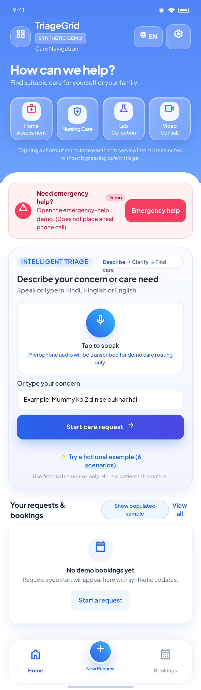
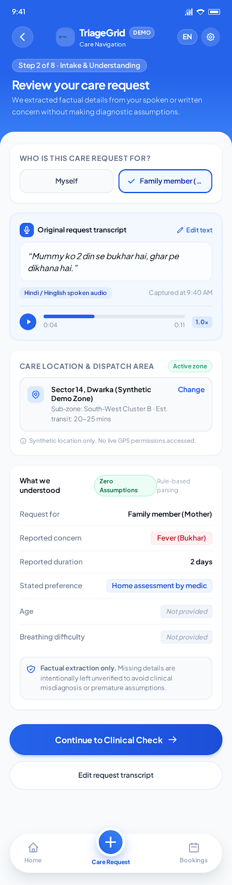
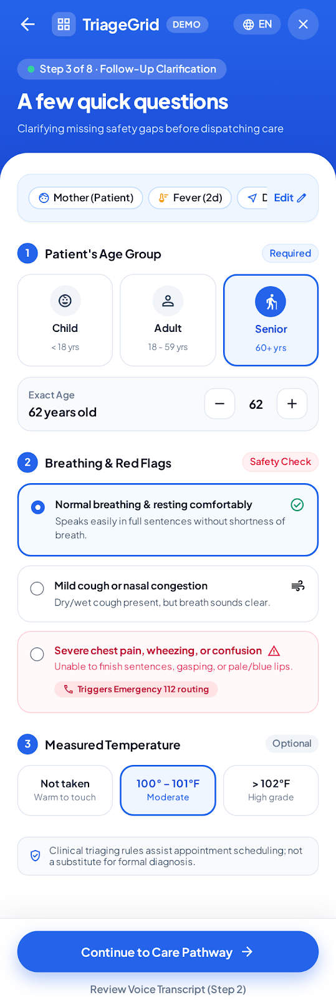
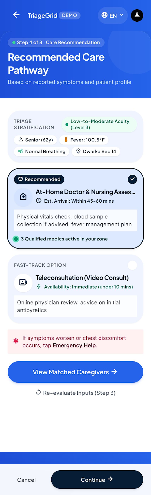
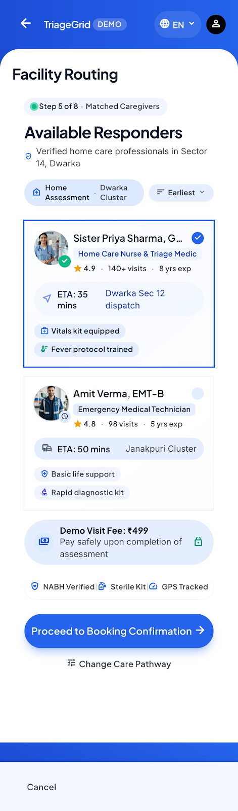
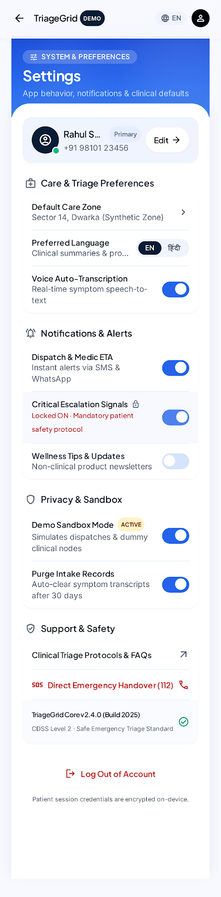
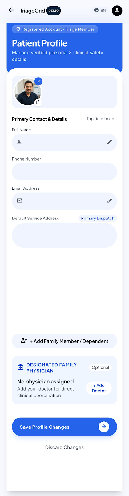
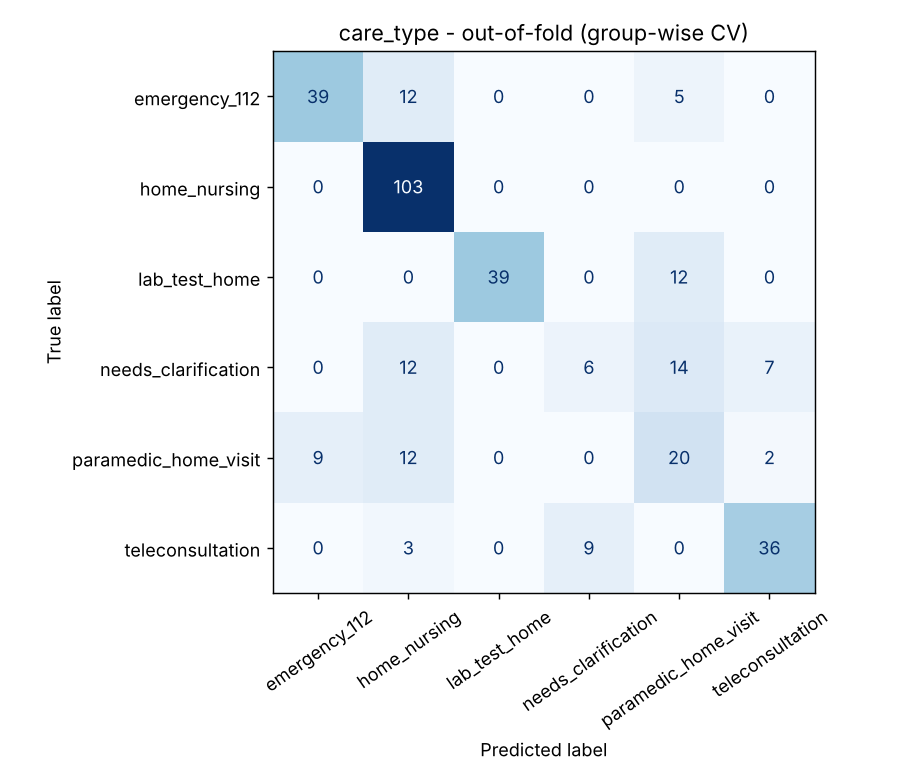

<div align="center">

# TriageGrid 🏥
### AI-Powered Clinical Triage & Multilingual Care-Navigation Platform
**Built for the CareCompass Challenge · IIIT-Delhi Hackathon**

[](https://www.python.org/)
[](https://fastapi.tiangolo.com/)
[](https://react.dev/)
[](https://www.typescriptlang.org/)
[](https://scikit-learn.org/)
[](https://ai.google.dev/)
[](https://vitejs.dev/)
[](https://github.com/nikhil-kumarrr/TriageGrid-IIITD/actions/workflows/ci.yml)
[](LICENSE)

*Multilingual conversational intake · Machine-learned care categorization · Qualification-based caregiver matching · Emergency hospital intelligence*

</div>

---

## 🏗️ System Architecture & Workflow

> Complete data flow: from multilingual patient audio/text intake, through FastAPI and scikit-learn ML pipelines, to proximity-based caregiver matching, LLM clinical reasoning, and external hospital intelligence.

```
Patient (Voice / Text in EN/HI/Hinglish)
                    ↓
        React 19 Frontend (Vite)
                    ↓
          FastAPI Backend Engine
         /          |          \
        ↓           ↓           ↓
ML Triage Engine  Caregiver   Conversational
(TF-IDF + LogReg)  Matcher      AI Assistant
[Care & Urgency]  [Distance,  (Gemini / Grok /
                  Skills,       Local Mock)
                  Languages]        ↓
        ↓           ↓        TinyFish Agent
  Emergency ER   Atomic      (Live Hospital
  Bypass Rule    Booking     Portal Research)
```

### How It Works

1. **Multilingual Patient Intake** — Accepts spoken audio (with in-browser speech recognition and editable transcript review) or direct text in English, Hindi, and Hinglish.
2. **Deterministic Red-Flag Safeguards** — Lexical and semantic triggers screen for life-threatening emergencies (e.g., severe dyspnea, acute chest pain) before any routine scheduling can occur.
3. **Dual-Pipeline ML Classification** — Grouped TF-IDF feature pipelines infer appropriate care category (`paramedic_home_visit`, `teleconsultation`, `nurse_visit`, `in_clinic`) and urgency (`routine`, `same_day`, `emergency`).
4. **Caregiver Matching & Slot Allocation** — Evaluates distance via Haversine geometry, medical qualifications, languages, ratings, and time-slot availability with transactional locking.
5. **Hospital Handover & Web Intelligence** — Emergency presentations trigger a simulated Golden Bay receiver dashboard and dispatch TinyFish agents to fetch verified emergency hospital desk contacts without leaking patient data.

---

## 📸 Application Screenshots

### 🏥 Care Navigation Home Dashboard
> Responsive entrypoint featuring quick intake actions, source dataset examples, language toggles, and accessible navigation.



---

### 🗣️ Conversational Intake & Symptom Understanding
> Real-time intake pipeline parsing patient statements, capturing symptom facts, and confirming extracted information.



---

### 🔍 Follow-Up & Adaptive Clarification
> Targeted follow-up clarifying ambiguities without repetitive prompts when symptoms require additional clinical context.



---

### 📋 Clinical Care Recommendation & Urgency Triage
> Machine-learned categorization classifying request into proper care levels and urgency status with clear factual reasoning.



---

### 👨‍⚕️ Caregiver Matching & Slot Reservation
> Qualified caregivers ranked by distance, role eligibility, patient language alignment, and verified schedule availability.



---

### ⚙️ App Settings & Accessibility Preferences
> Granular user settings including language selection (English, Hindi, Hinglish), text magnification, and reduced motion.



---

### 👤 Patient Profile & Care History
> Manage registered patient credentials, contact details, emergency guardians, and historical triage sessions.



---

## 🧪 Clinical Modules & Architecture Highlights

| Module | Description |
|---|---|
| 🚨 **Emergency Escalation Protocol** | Bypasses non-urgent matching when acute red flags are detected, guiding the patient directly to emergency services. |
| 🏥 **Golden Bay Handover Preview** | Consented digital patient transfer preview simulating an emergency department triage receiver dashboard. |
| 🌐 **TinyFish Web Intelligence** | Real-time scraper fetching public phone numbers and emergency desk addresses from official hospital portals (e.g., AIIMS). |
| 🤖 **Interchangeable LLM Adapters** | Plug-and-play architecture supporting Google Gemini v1beta, xAI Grok, and a deterministic local Mock adapter. |
| 🔒 **Transactional Slot Protection** | SQLite ACID transactions enforcing slot reservation idempotency and eliminating concurrent double-booking. |
| 📊 **Grouped Model Evaluation** | Grouped k-fold validation on Sanocare synthetic datasets ensuring no train-test data leakage across repeated utterances. |

---

## 📊 Machine Learning Performance

The baseline models were trained on the Sanocare synthetic care-triage dataset v1 (340 rows, 65 distinct patient expressions):

- **Care Type Pipeline:** TF-IDF (word 1-3, char 3-5) + Logistic Regression — **Macro-F1: 0.6466**
- **Urgency Pipeline:** TF-IDF (word 1-3, char 3-5) + Logistic Regression — **Macro-F1: 0.6116**



---

## ⚡ Quick Start

> **Requirements:** Node.js 18+ and Python 3.10+

### 1. Clone and Configure

```sh
# Clone the repository
git clone https://github.com/nikhil-kumarrr/TriageGrid-IIITD.git
cd TriageGrid-IIITD

# Copy environment template
cp .env.example .env
```

### 2. Backend Setup (FastAPI)

```sh
# Create and activate virtual environment
python -m venv .venv
# Windows: .venv\Scripts\activate
# Linux/macOS: source .venv/bin/activate

# Install dependencies
pip install -r backend/requirements.txt

# Launch backend API server (runs on http://127.0.0.1:8000)
python run_backend.py
```

*Interactive API docs available at `http://127.0.0.1:8000/docs`.*

### 3. Frontend Setup (React 19 + Vite)

In a new terminal window:

```sh
cd frontend

# Install packages
npm install

# Start Vite development server
npm run dev
```

*Access the application at `http://127.0.0.1:5173`.*

---

## 🐳 Docker Deployment

Run the entire full-stack application with a single command:

```sh
docker compose up --build
```

- **Frontend Application:** `http://localhost:3000`
- **Backend API Docs:** `http://localhost:8000/docs`

---

## 🧪 Testing and Verification

```sh
# Run backend test suite (52 automated tests)
PYTHONPATH=backend pytest backend/tests -v

# Run dataset validation audit
python scripts/audit_data.py

# Test frontend type-checking and production build
npm run build
```

---

## 🛡️ Clinical Disclaimer & Ethics

- **Prototype Demonstration:** TriageGrid was developed exclusively as an academic prototype for the IIIT-Delhi CareCompass hackathon.
- **Not Medical Advice:** This system is not a certified medical device and does not provide clinical diagnoses, treatments, or prescriptions.
- **100% Synthetic Data:** Operates strictly on synthetic benchmarks provided by Sanocare Tech Innovations Pvt Ltd. No real patient data (PHI/PII) is processed or stored.
- **Simulated Operations:** Hospital handover screens and caregiver bookings are local mock simulations and do not dispatch actual emergency personnel.

---

## 🤝 Community & Contributing

Contributions are welcome! Please check our community guidelines:
- [Contributing Guide](CONTRIBUTING.md) — Setup instructions, git workflow, and testing practices.
- [Code of Conduct](CODE_OF_CONDUCT.md) — Contributor Covenant v2.1 standards.
- [Security Policy](SECURITY.md) — Vulnerability reporting and data boundary guidelines.

---

## 📄 License

This project is licensed under the MIT License - see the [LICENSE](LICENSE) file for details.

